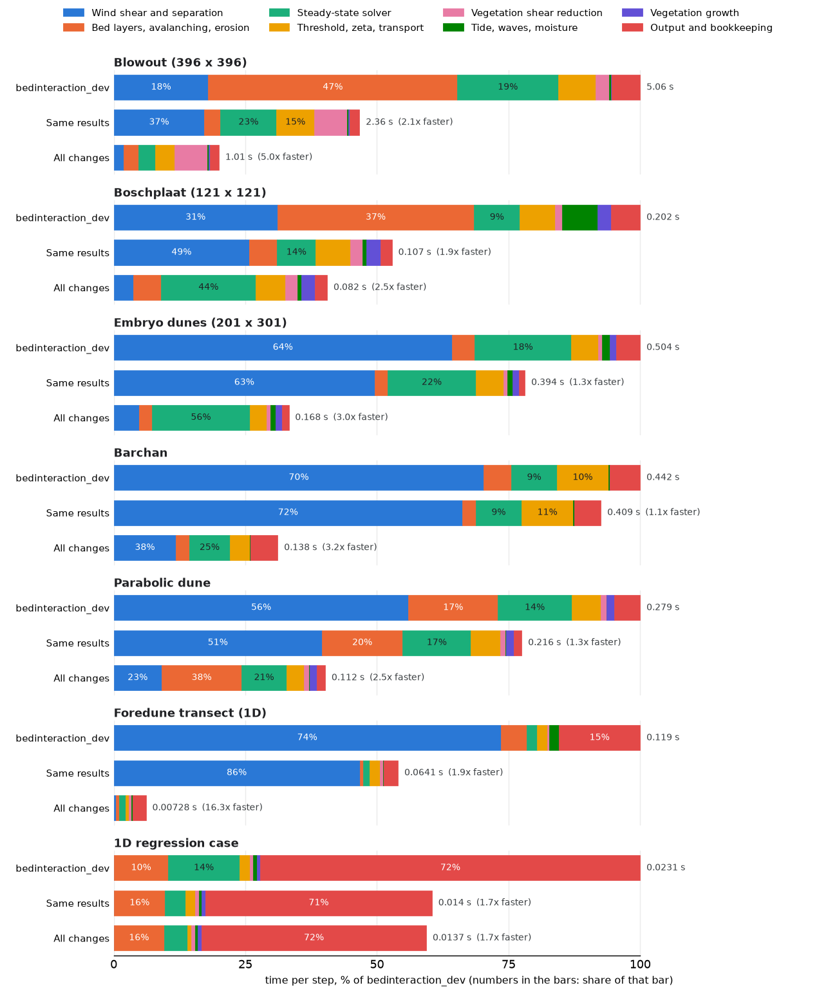
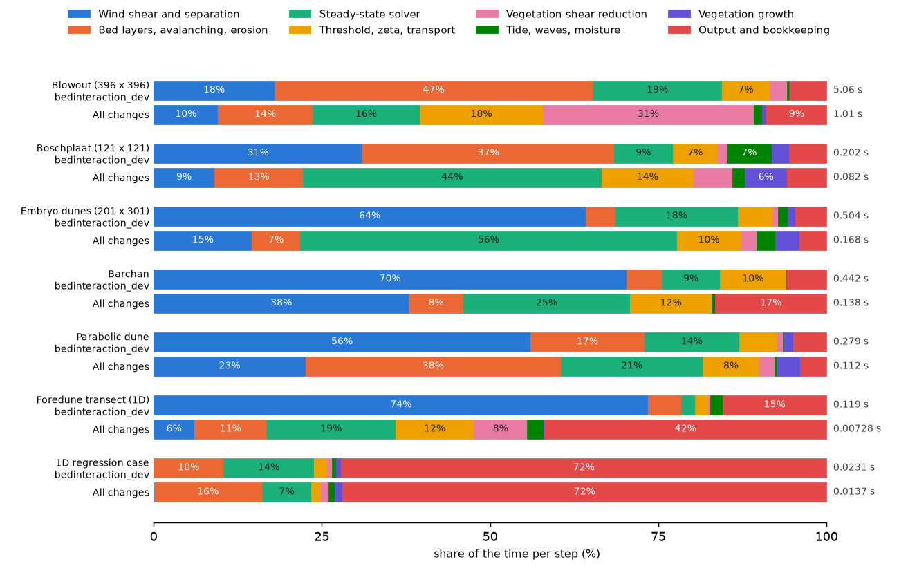

# Overview of aeolis-claude

This branch makes AeoLiS faster and fixes a number of errors in the model code. It starts from the
`bedinteraction_dev` branch (commit `4e5296d`) and changes only the model itself: the `aeolis/` folder
and `pyproject.toml`. The branch is meant for review and is not meant to be merged.

[This comparison](https://github.com/openearth/aeolis-python/compare/bedinteraction_dev...aeolis-claude)
shows every changed line. This document explains which changes matter and why.

## Types of changes

Most commits make the code faster and leave the results unchanged. We ran 13 test cases with both
versions and compared every output variable. The output is identical to the last bit. The test cases
include a blowout, a foredune, a barchan, a parabolic dune, embryo dunes, the Boschplaat on Terschelling
and the regression cases of the test suite.

The other commits change the results on purpose. They fix an error or add a better method. Their commit
messages start with `[physics]`. Each of them comes with a configuration key, so you can still switch
back to the old behaviour.

## Improvements

We measured every version on one core of the Deltares cluster (HYDRAX, 22 October 2026). All versions
of a case ran one after the other on the same node, so they share the same hardware. The first column
is `bedinteraction_dev`. The second column adds only the changes that keep the results the same. The
third column also includes the changes that alter results: the new shear method (`method_shear =
fft_grid`, with its default settings), the new solver order, the combined transport calculations and the
repaired time step.

| Case | `bedinteraction_dev` | Same results | All changes | Speed-up |
|---|---:|---:|---:|---:|
| Blowout, 14 days (396 × 396 cells) | 2055 s | 905 s | 353 s | 5.8× |
| Foredune transect, 1 year | 1079 s | 671 s | 66 s | 16× |
| Barchan, 60 days | 780 s | 723 s | 217 s | 3.6× |
| Parabolic dune, 60 days | 468 s | 406 s | 170 s | 2.8× |
| Embryo dunes, 60 days | 1423 s | 1156 s | 208 s | 6.8× |
| Boschplaat, 1 year (121 × 121 cells) | 2162 s | 1111 s | 662 s | 3.3× |

These are single runs. Shorter runs of the same cases (2 to 30 days), each repeated three times in turn,
give the same picture. Their medians are in the next table.

For a longer run: ten years of the Boschplaat at hourly steps take 4.8 hours with `bedinteraction_dev`,
2.7 hours with the changes that keep the results the same, and 1.3 hours with all changes. The last run
uses the new shear method with the settings calibrated for this case.

### Contribution per change

We ran each change that alters results on its own, on top of the changes that keep the results the
same. The table gives the speed-up of each version over "Same results", from the median of three runs.
The second column gives the speed-up of "Same results" over `bedinteraction_dev`.

| Case | Same results | Combined transport | Solver order | Time step | Shear on the model grid | All changes |
|---|---:|---:|---:|---:|---:|---:|
| Blowout, 2 days | 2.2× | 1.08× | 1.21× | 0.96× | 1.43× | 2.1× |
| Foredune transect, 7 days | 2.7× | 1.02× | 1.00× | 1.01× | 6.6× | 7.7× |
| Barchan, 7 days | 1.22× | 1.08× | 1.02× | 1.00× | 2.4× | 2.9× |
| Parabolic dune, 7 days | 1.62× | 1.03× | 1.07× | 1.02× | 1.67× | 1.89× |
| Embryo dunes, 7 days | 1.32× | 1.01× | 0.96× | 0.99× | 9.5× | 9.1× |
| Boschplaat, 30 days | 2.0× | 1.02× | 0.99× | 0.99× | 1.30× | 1.25× |

1. **Wind shear on the model grid** (section 1) gives the largest gain: 1.3 to 9.5 times faster on its
   own. It also changes the results more than any other commit.
2. **Bed layers in compiled code** (section 2), the faster time-series lookups (section 6) and the other
   changes that keep the results the same make the model 1.2 to 2.7 times faster.
3. **The new solver order** (section 3) saves 20 % on the blowout. On the other cases it saves almost
   nothing.
4. **Combined transport calculations** (section 4) save up to 8 %.
5. **The repaired time step** (section 5) fixes errors. It hardly changes the run time.

The next table shows how much each change alters the results. It gives the rms difference of the final
bed from `bedinteraction_dev`, in mm, for the longer runs of the first table. The rms of the bed change
itself is given for scale.

| Case | Bed change | Combined transport | Solver order | Time step | Shear on the model grid | All changes |
|---|---:|---:|---:|---:|---:|---:|
| Blowout, 14 days | 89 | 0 | 0.5 | 5.4 | 27 | 27 |
| Foredune transect, 1 year | 556 | < 0.001 | 6.8 | 5.1 | 189 | 192 |
| Barchan, 60 days | 7 | 0 | 0.05 | 1.1 | 1.2 | 1.3 |
| Parabolic dune, 60 days | 381 | 0.45 | 0.49 | 5.9 | 6.2 | 7.0 |
| Embryo dunes, 60 days | 40 | 0 | < 0.001 | 5.8 | 23 | 23 |
| Boschplaat, 1 year | 573 | 0 | 11.5 | 24 | 179 | 171 |

The changes that keep the results the same gave output identical to the last bit in all 15
comparisons, including the ten-year Boschplaat run.

### Computation time per model component

We measured the time per step of each part of the model for seven cases. The measurement leaves out
start-up and compilation. It comes from the same runs as the table above (median of three).

The first figure shows which parts became faster. Each case has three bars: `bedinteraction_dev`, the
changes that keep results the same, and all changes. The length of a bar is its time per step, as a
percentage of `bedinteraction_dev`.

The second figure shows the share of each part in the time per step, before and after. It shows what
takes the most time now.

Improved components:

- **Wind shear** took 56 to 74 % of the time on the barchan, parabolic dune, embryo dunes and foredune.
  The new shear method cuts it by a factor of 4 to 13 on the 2D cases. On the foredune transect, the
  shear now takes almost no time at all.
- **Bed layers** took 47 % on the blowout and 37 % on the Boschplaat. The compiled bed code cuts this
  part by a factor of 7 to 15.
- **Tide, waves and moisture** took 7 % on the Boschplaat. The faster time-series lookups cut this part
  by a factor of 7.
- **The solver** on the blowout went from 0.97 s to 0.16 s per step.
- **Transport** on the blowout went from 0.36 s to 0.19 s per step.

Remaining bottlenecks:

- **The solver** now takes the largest share on the embryo dunes (56 %), the Boschplaat (44 %) and the
  barchan (25 %). The embryo dunes and the barchan have periodic boundaries. Sand that leaves one side
  enters at the other, so the solver still needs several passes per step. On the Boschplaat, the new
  solver order takes 0.036 s per step with the new shear, against 0.015 s with the old shear.
- **Vegetation shear reduction** takes 31 % on the blowout. It became slower: 0.13 s per step before and
  0.32 s after. We have not yet found out why.
- **Output and bookkeeping** dominate small and 1D runs: 42 % on the foredune transect and 72 % on the
  1D regression case.
- **Bed layers** still take 38 % on the parabolic dune.

The speed-ups per step in the figures differ from the speed-ups of whole runs in the tables above.
Whole runs also include start-up, and some cases take more or fewer steps with the new code.

## 1. Wind shear on the model grid

Dunes change the wind. The wind speeds up over a crest and slows down in front of a dune. AeoLiS
computes this effect with the analytical solution of Weng et al. (1991). It splits the bed into waves
with a Fourier transform (FFT), computes the shear stress response to each wave and adds the responses
up.

The existing method (`method_shear = fft`) does this on a separate grid that is rotated with the wind.
The model copies the bed onto that grid, computes the shear there and copies the result back. This has
two drawbacks:

- The copying between the grids smooths and shifts the shear field.
- The rotated grid wraps around: its downwind edge connects to its upwind edge. On a beach that rises
  6 to 13 m across the domain, this connection acts as a cliff. The cliff produces a false peak in shear
  stress at the downwind edge and a false sheltered zone upwind of it.

The new method (`method_shear = fft_grid`) computes the shear directly on the model grid. It rotates the
wave directions in the Fourier transform instead of rotating the grid. Beyond the open edges, it extends
the bed with the edge values, so no cliff appears. We compared both methods with the same calculation on
a much larger domain, which serves as the reference. On the Boschplaat bed, the error in shear stress
drops from 19 % with the old method to 0.5 % with the new one.

The new method is optional. The default stays `method_shear = fft`. We are calibrating the new method
against the Boschplaat lidar data of 2014 to 2024 before we propose it as the default.

| Commit | What it does |
|---|---|
| [`17a99aa`](https://github.com/openearth/aeolis-python/commit/17a99aa) | Adds the new method. Its first name was `spectral`. |
| [`8257fcf`](https://github.com/openearth/aeolis-python/commit/8257fcf) | Computes the flow separation behind steep lee slopes on the model grid too, and supports periodic boundaries. |
| [`6bdc8fe`](https://github.com/openearth/aeolis-python/commit/6bdc8fe), [`5ec9f78`](https://github.com/openearth/aeolis-python/commit/5ec9f78), [`c6d1554`](https://github.com/openearth/aeolis-python/commit/c6d1554) | The first version subtracted the average slope of the bed before the Fourier transform. That removed the real speed-up of the wind over a sloping beach. The later two commits switch it off and remove the option. |
| [`663d687`](https://github.com/openearth/aeolis-python/commit/663d687) | Switches off the smoothing filter by default. The filter removed the response to bed waves of two to three cells. Those waves then no longer flattened out and grew into stripes on the Boschplaat foredune. |
| [`29fc9e7`](https://github.com/openearth/aeolis-python/commit/29fc9e7) | Renames `spectral` to `fft_grid`. The old name still works. |
| [`e1379ab`](https://github.com/openearth/aeolis-python/commit/e1379ab) | Adds `shear_transfer`, the formula for the response to each wave. `weng` is the existing formula with one length scale L. `weng_mode` uses the wavelength itself as L, so L is no longer a tuning parameter. `fca2010` uses the fit of Fourrière, Claudin and Andreotti (2010). |
| [`3b32ab6`](https://github.com/openearth/aeolis-python/commit/3b32ab6) | Adds `shear_short_waves`, an optional damping of waves only a few cells long. The default is `none`. |
| [`c8c6962`](https://github.com/openearth/aeolis-python/commit/c8c6962) | Adds `shear_scale_A` and `shear_scale_B`. A sets how much the shear stress rises on a crest. B sets how far upwind of the crest the stress peaks; this shift is what makes dunes grow. The keys multiply A and B of the chosen formula. |
| [`b8041cf`](https://github.com/openearth/aeolis-python/commit/b8041cf) | Speeds up the existing `fft` method. It computes the parts that depend only on the grid once instead of every step. Same results. |

Main files: [`aeolis/processes/shear/spectral.py`](aeolis/processes/shear/spectral.py),
[`aeolis/processes/shear/separation.py`](aeolis/processes/shear/separation.py),
[`aeolis/wind.py`](aeolis/wind.py) and [`aeolis/constants.py`](aeolis/constants.py).

## 2. Bed layers in compiled code

AeoLiS stores the bed as a stack of layers, each with its own grain size distribution. Every time step,
`bed.update` and `bed.mixtoplayer` move sediment between these layers. The old code did this with numpy
operations over the whole grid, layer by layer. The new code loops over each column of layers in
compiled code (numba). The results stay identical to the last bit.

| Commit | What it does |
|---|---|
| [`15a5c8e`](https://github.com/openearth/aeolis-python/commit/15a5c8e) | Adds the compiled functions. It also pins `setuptools<81`, which `bmi-python` needs. |
| [`8fd5f3b`](https://github.com/openearth/aeolis-python/commit/8fd5f3b) | Adds up numbers in the same order as numpy, so the results match to the last bit. |
| [`4eba5e0`](https://github.com/openearth/aeolis-python/commit/4eba5e0) | Uses the compiled functions in `bed.update` and `bed.mixtoplayer`. |
| [`cc3db0a`](https://github.com/openearth/aeolis-python/commit/cc3db0a) | Skips cells where no sand was picked up. |

Main files: [`aeolis/processes/bed/layers.py`](aeolis/processes/bed/layers.py) and [`aeolis/bed.py`](aeolis/bed.py).

## 3. Solver order

The steady-state solver computes the sediment concentration in the air. Each cell depends on its upwind
neighbours. The old solver sweeps the grid once for each wind quadrant and repeats the sweeps until the
concentrations stop changing. On the blowout, this takes 20 to 60 sweeps per time step.

The new solver visits the cells in upwind order: each cell comes after the cells it depends on. Most
cells are then solved in a single visit. Where the wind circles back, the solver iterates only over that
small group of cells.

Both solvers converge to the same solution. Small differences remain, because the old solver stops at
its convergence limit. On the blowout, the solver time per step drops from 0.61 s to 0.18 s. With
`solver_order = quadrant` you get the old sweeps back.

| Commit | What it does |
|---|---|
| [`e481d5c`](https://github.com/openearth/aeolis-python/commit/e481d5c) | Runs the old sweeps in compiled code. Same results. |
| [`f6348f7`](https://github.com/openearth/aeolis-python/commit/f6348f7) | Lets the sweeps accept every boundary type, as the rest of the model does. |
| [`865b499`](https://github.com/openearth/aeolis-python/commit/865b499) | Adds the new solver order and makes it the default (`solver_order = upwind`). |

Main files: [`aeolis/processes/solvers/steadystate.py`](aeolis/processes/solvers/steadystate.py) and
[`aeolis/advection.py`](aeolis/advection.py).

## 4. Combined transport calculations

Grain speed, equilibrium transport and the vegetation part of zeta used about 100 separate numpy
operations per time step. Each operation passed over the whole grid. Now one compiled loop does all of
it per cell. On the blowout, transport takes 0.05 s per step instead of 0.28 s, and zeta takes 0.02 s
instead of 0.07 s.

The results differ from the numpy version by about 1e-12. These differences come from rounding. On
most cases they stay that small: after 60 days to a year, the final bed differs by less than 1 µm. On
the parabolic dune they grow: after 60 days the bed differs by up to 2.7 cm (rms 0.45 mm).
`fused_kernels = F` switches back to the numpy version.

| Commit | What it does |
|---|---|
| [`4fdac35`](https://github.com/openearth/aeolis-python/commit/4fdac35) | Combines grain speed, equilibrium transport and zeta into compiled loops. |
| [`cf81581`](https://github.com/openearth/aeolis-python/commit/cf81581) | Computes the `duran_full` grain speed for several grid rows at once. Same results. |
| [`b814e8a`](https://github.com/openearth/aeolis-python/commit/b814e8a) | Computes the Okin lee-side reduction for several grid rows at once. Same results. |

Main files: [`aeolis/processes/transport/kernels.py`](aeolis/processes/transport/kernels.py),
[`aeolis/processes/transport/zeta_kernels.py`](aeolis/processes/transport/zeta_kernels.py),
[`aeolis/transport.py`](aeolis/transport.py) and [`aeolis/zeta.py`](aeolis/zeta.py).

## 5. Time-step limiter

AeoLiS shortens the time step when the bed changes too fast (`max_bedlevel_change`). This limiter had
five errors:

- `bed.initialize` overwrote `max_bedlevel_change`, so the value from the configuration file never
  applied.
- The limiter looked at the largest bed rise only, so it never limited erosion.
- It included avalanching in the bed change. Avalanching does not scale with the time step, so the time
  step could only shrink.
- After a short step, the time step jumped straight back to its full length.
- The output times drifted, and the model never wrote the output at `tstop`.

The new limiter (`dt_limiter = aeolian`) looks only at the bed change from wind transport. It also
shortens steps so that they end exactly on every output time and on `tstop`. `dt_limiter = legacy`
gives the old behaviour.

| Commit | What it does |
|---|---|
| [`45e6f8d`](https://github.com/openearth/aeolis-python/commit/45e6f8d) | Adds the new limiter and makes it the default. The model no longer runs one step past `tstop` (`tstop_inclusive = F`). |
| [`3b1d0a5`](https://github.com/openearth/aeolis-python/commit/3b1d0a5) | Switches off the limit on how fast the time step may grow again (`dt_growth = 0`). |

Main files: [`aeolis/model.py`](aeolis/model.py), [`aeolis/bed.py`](aeolis/bed.py) and
[`aeolis/constants.py`](aeolis/constants.py).

## 6. Start-up, output and bookkeeping

| Commit | What it does |
|---|---|
| [`a21c105`](https://github.com/openearth/aeolis-python/commit/a21c105) | Stores every compiled function on disk, so the next run does not compile it again. Passes `dt` always as a float; an integer `dt` used to compile a second version of every function. Loads the plotting libraries only when needed: `import aeolis` takes 1.5 s instead of 2.8 s. |
| [`3ae5283`](https://github.com/openearth/aeolis-python/commit/3ae5283) | Opens the netCDF file once per output time instead of twice, and stops copying output variables that have no statistics. |
| [`d4bd5b2`](https://github.com/openearth/aeolis-python/commit/d4bd5b2) | Uses half the logical processors by default and lets idle threads sleep instead of wait actively. The environment variable `AEOLIS_THREADS` sets another number. |
| [`a76e51e`](https://github.com/openearth/aeolis-python/commit/a76e51e) | Skips the grid rotation when the grid is not rotated. |
| [`6ff269c`](https://github.com/openearth/aeolis-python/commit/6ff269c) | Looks up the tide, waves and wind of each time step faster. The time series are stored column by column, and the sine and cosine of the wind direction are computed only for the record in use. Also sums the bed layers in place, computes A and B of `fca2010` once per wavenumber and rotates with `np.dot`. On the Boschplaat, a step takes about 40 % less time. |

All of these keep the results the same. Main files: [`aeolis/netcdf.py`](aeolis/netcdf.py),
[`aeolis/model.py`](aeolis/model.py), [`aeolis/utils.py`](aeolis/utils.py) and
[`aeolis/__init__.py`](aeolis/__init__.py).

## 7. Bug fixes

| Commit | What it does |
|---|---|
| [`acab61a`](https://github.com/openearth/aeolis-python/commit/acab61a) | Makes the `euler_backward` solver fully implicit. It used to run Crank–Nicolson without saying so. This changes results. |
| [`2260bc3`](https://github.com/openearth/aeolis-python/commit/2260bc3) | Old solver names such as `trunk` and `pieter` crashed the model. They now map to the current solvers with a warning. |
| [`48e332c`](https://github.com/openearth/aeolis-python/commit/48e332c) | Fixes four crashes and errors: `1Dstacks` shear, restart files written as text, runs of zero steps and the missing `tveg` in the BMI interface. |
| [`2938ab3`](https://github.com/openearth/aeolis-python/commit/2938ab3) | Gives the dune erosion coefficient `Cs` a default value again. Without it, the model stopped with a KeyError. |
| [`d784341`](https://github.com/openearth/aeolis-python/commit/d784341) | Removes code that nothing used or that did not work, such as `advection_old.py`. |
| [`7733c91`](https://github.com/openearth/aeolis-python/commit/7733c91) | Updates the reference output of the regression tests to the new defaults. |

## Known open issues

Each of these fixes would change results, so they need a decision first:

- `gridparams` swaps ds and dn. This matters only for cells that are not square.
- `erosion.py` uses `np.max` where it should use `np.maximum`.
- `shear.py` indexes z0 with a Fourier mask. This matters only when z0 varies in space.
- `Cu` and `Ct` are scaled by `accfac`.
- The size of the separation bubble depends on the grid cell size.

## Scope of this branch

We developed this work on a separate branch that also holds the test cases, the comparison scripts, the
cluster scripts and new unit tests. This branch leaves them out, so that it shows only the model code.
Some commit messages still refer to them, for example to the "gate", the script that checks that results
stay identical to `bedinteraction_dev`.
